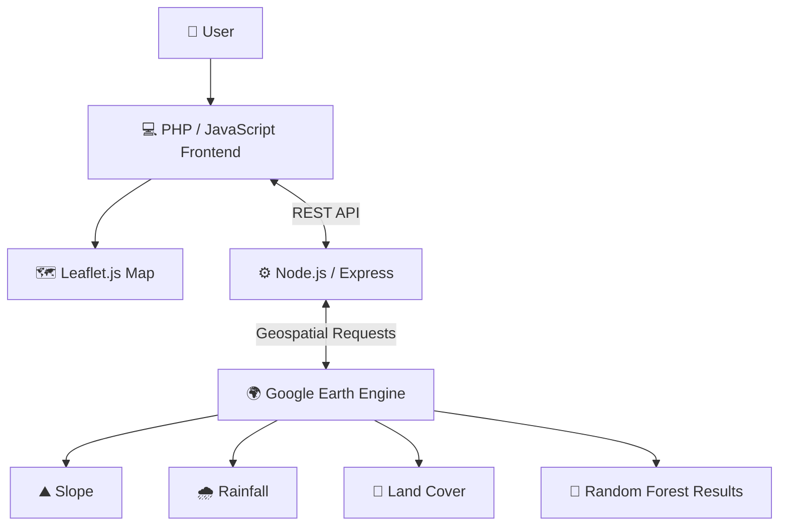

# 🗺️ Mining Impact Vulnerability Mapping — WebGIS

<p align="center">
  
  
  
  
  
  
</p>

<p align="center">
  A web-based Geographic Information System for visualizing and analyzing potential mining impact vulnerability in South Konawe Regency, Indonesia.
</p>

<p align="center">
  <b>Geospatial Analysis · Random Forest · Remote Sensing · Web Development</b>
</p>

---

## 📸 Application Preview


### Dashboard Overview


### Random Forest Vulnerability Map


### Point Identification


### Spatial Analysis


---

## 🌍 Project Overview

Mining activities can influence surrounding environmental conditions. This project was developed to support the spatial identification and visualization of areas with different levels of potential mining impact vulnerability.

The application integrates **Random Forest classification**, **Google Earth Engine**, and **Leaflet.js** to provide an interactive platform for exploring geospatial information.

The study focuses on mining areas around Palangga Selatan, South Konawe Regency, Southeast Sulawesi, Indonesia.

### 🎯 Project Objectives

- Visualize potential mining impact vulnerability through an interactive map.
- Integrate multiple environmental parameters for spatial analysis.
- Apply Random Forest classification to identify vulnerability levels.
- Provide spatial information through point identification and area statistics.

## ✨ Key Features

| Feature | Description |
|---|---|
| 🗺️ Interactive WebGIS | Explore geospatial information through an interactive map. |
| 🌳 Random Forest Classification | Visualize classification results generated using Random Forest. |
| 🌧️ Environmental Parameters | Explore slope, rainfall, and land-cover layers. |
| 📍 Point Identification | Retrieve spatial information from selected map coordinates. |
| 📊 Area Statistics | Display area statistics based on selected layers. |
| 🏭 Mining Area Information | Explore contextual information about the study area. |

## 🛰️ Data Sources

The analysis uses three environmental parameters:

| Parameter | Data Source | Description |
|---|---|---|
| ⛰️ Slope | SRTM / USGS | Terrain slope derived from elevation data at 30 m resolution. |
| 🌧️ Rainfall | Company rainfall data (2025) | Rainfall information used as an environmental parameter. |
| 🌳 Land Cover | ESA WorldCover 2020 | Land-cover classification data. |

## 🧠 Random Forest Model

The Random Forest model was developed using the following configuration:

| Configuration | Value |
|---|---:|
| Total sample points | 300 |
| Training samples | 222 |
| Testing samples | 78 |
| Number of trees | 100 |
| Training/testing split | 70:30 |
| Accuracy | **84.00%** |
| Kappa coefficient | **0.7695** |

### Classification Results

| Class Value | Vulnerability Level |
|---:|---|
| 0 (Random Forest) | 🟢 Safe |
| 1 (Random Forest) | 🟡 Moderate |
| 2 (Random Forest) | 🔴 Vulnerable |

The original parameter classification uses values 1, 2, and 3 respectively for Safe, Moderate, and Vulnerable.

> **Note:** The model evaluation represents results from the available sample data. The resulting map provides preliminary spatial information and should not be treated as an official decision-making reference without further field validation.

## 🏗️ System Architecture



### Technology Stack

| Category | Technologies |
|---|---|
| Frontend | PHP, HTML5, CSS3, JavaScript |
| Map Visualization | Leaflet.js |
| Backend | Node.js, Express.js |
| Geospatial Processing | Google Earth Engine |
| Machine Learning | Random Forest |
| Geospatial Data | SRTM, ESA WorldCover, Rainfall Data |
| Development Tools | VS Code, Git, GitHub |

## 🔌 Backend API Endpoints

| Method | Endpoint | Description |
|---|---|---|
| GET | `/api/status` | Check backend status |
| GET | `/api/debug-assets` | Inspect configured GEE assets |
| GET | `/api/tile/:layer` | Generate map tile layers |
| GET | `/api/identify` | Retrieve information at selected coordinates |
| GET | `/api/area-stats` | Retrieve area statistics |

## 🚀 Local Installation

### Prerequisites

- PHP and Apache (XAMPP recommended)
- Node.js and npm
- Google Cloud service account with Google Earth Engine access
- Permission to access the configured Google Earth Engine assets

### 1. Clone the Repository

```bash
git clone https://github.com/ayustinasamudin05/web-gis-mining-impact.git
cd web-gis-mining-impact
```

### 2. Set Up the Frontend

Move the project folder into the XAMPP `htdocs` directory.

Start Apache using XAMPP Control Panel, then access:

```text
http://localhost/web-gis-mining-impact/
```

### 3. Install Backend Dependencies

```bash
npm install
```

### 4. Configure Google Earth Engine

Create a local `.env` file based on the configuration expected by `server.js` and `earthengine.js`.

Provide a valid Google Cloud service account credential file and configure its path using `GEE_KEY_FILE` if necessary.

Ensure the service account has permission to access all configured Google Earth Engine assets.

**🔐 Security:** Never commit `.env` files or service account credentials to GitHub.

### 5. Start the Backend

```bash
npm start
```

The backend runs at:

```text
http://localhost:3000
```

Check the backend status:

```text
http://localhost:3000/api/status
```

## ⚠️ Limitations

- The analysis uses selected environmental parameters and available datasets.
- Classification results depend on the quality, resolution, and availability of input data.
- Model evaluation results do not independently establish field-level accuracy.
- Further field validation is required before using the map as an official basis for environmental or mining-related decisions.

## 👩‍💻 Project Purpose

This project was developed as an academic and technical portfolio project to demonstrate the integration of:

- Geographic Information Systems (GIS)
- Remote sensing and spatial data processing
- Machine learning classification
- REST API development
- Interactive web application development

---

<p align="center">
  <b>Built with curiosity and geospatial technology.</b>
  <br>
  Informatics Engineering · Academic Portfolio Project
</p>
